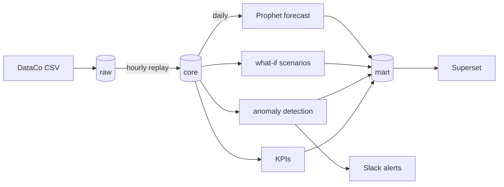

# DA-03 Retail and Supply Chain Control Tower

Pipeline that watches stock, deliveries and suppliers for a retailer, refreshes every hour, and sends an alert when something goes wrong.



Postgres holds four schemas: `raw`, `core`, `ops` and `mart`. Airflow runs two DAGs, Superset reads from `mart`, and alerts go to a Slack webhook (or the log if none is set).

## Data

- Real: orders, products, categories, sales, scheduled and actual shipping days from the DataCo Smart Supply Chain dataset.
- Simulated: the 8 suppliers and which product belongs to which, inventory levels, reorder points, purchase orders and lead times. Stock starts at 30 days of demand and drops as real orders come in.
- The dataset is historical, so each hourly run replays the next slice of orders (24 hours of data per run by default). The pipeline is real, the feed is not.

## KPIs

- stock-out rate: SKUs with no stock divided by active SKUs
- on-time delivery: share of deliveries in the last 7 days that arrived within the promised days
- supplier lead time: average and p90 over the last 30 days
- days of inventory: units on hand divided by average daily demand over 14 days

## Hourly DAG

`replay_orders`, `update_inventory`, `compute_kpis`, `refresh_whatif_scenarios`, `detect_anomalies`, `send_alerts`, `data_quality_checks`

- Anomalies are a z-score of each supplier's average delay and each category's daily demand against the previous 14 runs. A value is flagged when z is at least 3 and the change is also at least 2 days (delay) or 5 units (demand). Only increases count.
- Alerts fire on KPI thresholds (stock-out over 10%, on-time under 80%, days of inventory under 7) and on anomalies. Each alert key is sent at most once per 24 hours, and a higher severity counts as a new key.
- Data quality checks cover null keys, orphan order items, negative inventory, duplicate shipments and a missing KPI row. The task fails if one fails.

## Daily DAG

Prophet forecasts 14 days of demand for the 12 biggest categories. A 14 day holdout gives MAPE and WAPE per category (WAPE is steadier for small categories). `mart.forecast_vs_stock` compares the forecast to current stock and gives days of cover.

## What-if

For each supplier and each extra delay from 0 to 14 days, a product is short when `daily demand x (lead time + delay) - on hand` is positive. `mart.scenario_results` stores products at risk, units short and revenue at risk. Purchase orders already in transit are ignored.

## Setup

You need Docker, Python 3.10+, and the DataCo CSV from Kaggle saved as `data/DataCoSupplyChainDataset.csv`.

```
pip install -r requirements.txt
docker compose up -d --build
python scripts/load_dataco.py data/DataCoSupplyChainDataset.csv
python scripts/fast_forward.py --cycles 40
```

- Airflow: http://localhost:8080, user `admin`, password from `docker compose exec airflow cat /opt/airflow/standalone_admin_password.txt`
- Superset: http://localhost:8088, `admin` / `admin`. Add the database `postgresql+psycopg2://ct:ct@db:5432/control_tower`.
- Slack: copy `.env.example` to `.env`, set `SLACK_WEBHOOK_URL`, then `docker compose up -d`
- Pause the hourly DAG while running `fast_forward.py`, since both move the same simulated clock.

## Demo

```
python scripts/inject_delay.py --supplier S03 --days 7
python scripts/fast_forward.py --cycles 2
python scripts/inject_delay.py --supplier S03 --clear
```

The delay shows up in `mart.anomalies` and `mart.alert_log`, and `mart.scenario_results` shows which products would run out.

## Tests

```
pytest
python tests/make_fake_dataco.py data/fake_dataco.csv
python scripts/load_dataco.py data/fake_dataco.csv
```

The last two commands generate a small fake file in DataCo's format so the pipeline can be tried without the Kaggle download. It is only for testing.

`python scripts/export_snapshots.py` writes every mart table to `exports/` as JSON and CSV.

## Limitations

- The injected delay is a demo control, not a real incident.
- Inventory and supplier data are simulated, so absolute numbers are illustrative.
- Z-scores on short series can still give an occasional false alarm.
- The forecast is a basic model (trend and weekly seasonality) and the backtest error is stored with it.
- Superset runs locally, so the submission uses screenshots.
